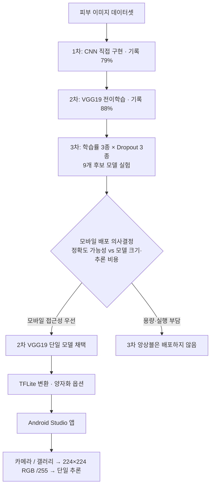

# Mpox Image Classification

> **정확도가 가장 높은 모델이 아니라, 실제 사용자가 이용할 수 있는 모델을 선택하다.**  
> ABC 부트캠프 | CNN → VGG19 → 9개 실험 모델 → **2차 모델 최종 선택** → TensorFlow Lite → Android 앱

피부 이미지 기반 엠폭스(Mpox) 분류 모델을 개발하고, Android Studio로 촬영·이미지 선택·분류 결과 표시 기능을 구현한 프로젝트입니다. 특히 **분류 정확도뿐 아니라 모델 크기, 모바일 실행 부담, 사용자 접근성**을 함께 고려하여 최종 모델을 선정했습니다.

> ⚠️ **학습용 프로토타입**입니다. 이미지 분류 결과만으로 엠폭스를 진단하거나 감염 여부를 확정할 수 없습니다. 의료 판단에는 사용하지 마세요.

## 핵심 설계 결정: 왜 3차가 아니라 2차 모델인가?

- **1차 CNN:** 모델 구조를 직접 설계한 기준 실험. 소스코드 주석에 최대 정확도 **79%** 기록.
- **2차 VGG19:** ImageNet 사전학습 VGG19 특징 추출기와 별도 분류 헤드를 결합. 소스코드 주석에 최대 정확도 **88%** 기록.
- **3차 확장 실험:** 2차 모델을 출발점으로 학습률 `0.001 / 0.0001 / 0.01`과 Dropout `0.2 / 0.3 / 0.4`를 조합한 **9개 후보 모델**을 실험. 앙상블을 통해 성능이 향상될 *가능성*은 있지만, 향상은 보장되지 않으며 저장·메모리·추론 비용과 함께 평가해야 합니다.
- **최종 의사결정:** 모바일 앱에 여러 모델을 탑재하면 앱 용량과 실행 부담이 커질 수 있습니다. **모바일 사용자 접근성과 성능의 균형**을 우선해 3차 후보/앙상블을 배포하지 않고 **2차 단일 모델**을 선택했습니다.
- **Android 구현:** 선택한 2차 모델을 TensorFlow Lite 형식으로 변환해 앱의 로컬 추론에 사용했습니다.

> 79%와 88%는 원본 소스코드의 **역사적 기록값**입니다. 별도 평가 로그가 없어 동일 조건의 독립 테스트 정확도라고 확정할 수 없습니다. 또한 9개 모델의 앙상블 정확도 향상이 실측되었다고 주장하지 않습니다.

### 모델 선정·배포 다이어그램


<details>
<summary>GitHub Mermaid 다이어그램 소스 보기</summary>


</details>

## 기술 스택

| 영역 | 기술 | 사용 목적 |
| --- | --- | --- |
| 모델 | Python, TensorFlow / Keras | 이미지 이진 분류 모델 학습·저장 |
| 아키텍처 | CNN, VGG19 (ImageNet) | 기준 모델 구현, 사전학습 특징 추출 |
| 실험 | Adam, Dropout, ModelCheckpoint | 학습률·규제 설정 실험 및 체크포인트 |
| 모바일 모델 | TensorFlow Lite | Android에서 로컬 추론 |
| 모바일 앱 | Android Studio, Kotlin, CameraX | 촬영·갤러리 이미지 선택 및 결과 표시 |

**모델 입력·출력:** `224×224×3` RGB, `[0,1]` 정규화, sigmoid 단일 출력. 이진 분류의 **클래스 인덱스 매핑은 실제 데이터셋으로 확인**해야 합니다.

## 모델 개발 단계

| 단계 | 구현 내용 | 결과/의미 | 배포 |
| --- | --- | --- | --- |
| v1 | Conv2D 2개 + Flatten + Dense 헤드 | 주석상 최대 79% | 아니요 |
| v2 | 고정된 ImageNet VGG19 + Dense/Dropout 헤드 | 주석상 최대 88% | **선택** |
| v3 | v2 체크포인트에서 9개 독립 후보 학습 | 성능 개선 가능성 탐색, 운영 비용과 비교 | 아니요 |
| TFLite | v2 모델 형식 변환, 양자화 선택지 | 모바일 환경에 맞춘 배포 준비 | Android 단일 모델 |

### v1 — Scratch CNN

`Conv2D(32) → Pool → Conv2D(64) → Pool → Flatten → Dense(512) → Dropout(0.5) → Dense(256) → Dropout(0.3) → Sigmoid`

### v2 — Transfer Learning

`VGG19(include_top=False, weights=imagenet, frozen) → Flatten → Dense(512) → Dropout(0.5) → Dense(256) → Dropout(0.3) → Sigmoid`

과거 프로젝트의 Python 학습 코드와 Android 앱은 모두 **RGB/255** 전처리를 사용했습니다. VGG19의 표준 `preprocess_input` 방식으로 임의 변경하면 *기존 모델/앱과 입력 분포가 달라집니다.* 이번 수정본은 호환성을 위해 기존 전처리를 보존합니다.

### v3 — Experimental Candidates (not deployed)

수정된 v3는 **실제로 2차 모델 파일을 불러오며**, 실험마다 새로운 가중치 인스턴스를 로드합니다. 학습률 3종 × Dropout 3종을 조합하고 **VGG19 특징 추출기는 고정**한 채 분류 헤드를 재학습합니다. 이는 VGG19 본체를 풀어 학습하는 전체 파인튜닝이 아닙니다. 선택적으로 `--evaluate-ensemble`로 9개 모델의 **평균 확률 소프트 보팅**을 오프라인에서 평가할 수 있지만 Android에 이 기능을 배포한 것은 아닙니다.

## Android 앱과 실제 모델 크기

업로드된 Android Studio 프로젝트를 검토한 결과, 앱의 `assets`에는 **`model_v2.tflite` 한 개**가 들어 있고 그 파일 크기는 **132,018,708 bytes (약 125.9 MiB)**입니다. 따라서 **TFLite 파일 형식으로 변환되었다는 사실만으로 경량화가 충분히 달성되었다고 단정할 수 없습니다.**

원본 Android 코드는 같은 모델을 세 번 호출해 다수결을 계산합니다. **동일한 모델의 동일 입력을 세 번 실행하는 것은 3개 모델 앙상블이 아닙니다.** 이번 정리본의 Android `MainActivity.kt`는 단일 TFLite 호출로 수정했습니다.

이번 `Model_Lightweighting.py`는 원본 변환 로직에서 위험한 레이어 재초기화 처리를 제거하고, 실제 파일 크기를 비교할 수 있도록 **양자화 옵션**(`none`, `dynamic`, `float16`)과 크기 리포트를 추가했습니다. `dynamic`은 **가중치 크기 축소를 시도**하는 옵션이지만 최종 용량, 기기 호환성, 정확도, 실제 속도는 실행 후 확인해야 합니다. 과거 제공된 132MB 파일을 이 옵션으로 변환해 검증한 것은 아닙니다.

> ⚠️ **배포 전 필수 확인:** 원본 데이터 폴더의 `class_indices`에서 어느 인덱스가 Mpox인지 확인하세요. 현재 Android 앱은 **인덱스 1이 Mpox라는 기존 코드의 가정**을 유지합니다. 만약 실제 인덱스가 0이면 결과 메시지가 반대로 출력됩니다.

## 디렉터리 구성

```text
Mpox-Image-Classification/
├── README.md
├── Mpox_classification_v1.py       # CNN 기준 모델
├── Mpox_classification_v2.py       # 최종 선택 모델: VGG19
├── Mpox_classification_v3.py       # 9개 후보 (실험용, 미배포)
├── Model_Lightweighting.py         # v2 → TFLite, 양자화 옵션
├── requirements.txt
├── diagrams/
│   ├── model-selection.svg
│   ├── model-selection.png
│   └── model-selection.dot
├── docs/
│   └── REVIEW_AND_DECISIONS.md
├── Android-App/                   # 검토·수정한 Android 소스
│   └── app/src/main/assets/README.md
├── models/                        # 생성 모델 (*.keras 제외)
└── artifacts/                     # 변환 산출물 (*.tflite 제외)
```

> GitHub 소스 ZIP에는 132MB 모델 바이너리를 넣지 않았습니다. 일반 Git 파일 업로드의 크기 제한을 넘을 수 있으므로 Git LFS 또는 Release 자산을 사용하세요. 기존 바이너리는 사용자가 제공한 `Application.zip`에 들어 있습니다.

## 데이터셋 배치

```text
Mpox/Fold1/Fold1/Fold1/
├── Train/<class_A>/*.jpg
│         <class_B>/*.jpg
├── Val/<class_A>/*.jpg
│       <class_B>/*.jpg
└── Test/<class_A>/*.jpg
         <class_B>/*.jpg
```

데이터셋·가중치 파일은 학습용 코드 첨부에 제공되지 않았습니다. 자체 준비한 이진 분류 폴더를 사용해야 하며, 환자 이미지와 관련 개인정보·라이선스를 확인한 후 다뤄야 합니다.

## 실행 방법

아래는 소스 실행 예시입니다. **이 환경에서는 TensorFlow·원본 학습 데이터가 없어 실제 재학습/변환/모바일 빌드는 실행 검증하지 못했습니다.** Python 구문 검사와 파일 구조·참조 관계 검토만 수행했습니다.

```bash
python -m venv .venv
source .venv/bin/activate
pip install -r requirements.txt

# 1차 기준 CNN
python Mpox_classification_v1.py --data-root Mpox/Fold1/Fold1/Fold1

# 2차 VGG19 선택 모델
python Mpox_classification_v2.py --data-root Mpox/Fold1/Fold1/Fold1

# 3차 확장 실험 (모바일 배포용이 아님)
python Mpox_classification_v3.py --base-model models/monkeypox_classification_model2.keras

# 선택: 오프라인 앙상블 성능 확인
python Mpox_classification_v3.py --evaluate-ensemble

# 2차 모델 → TFLite (기본: 동적 범위 양자화 시도)
python Model_Lightweighting.py --quantization dynamic --verify-parity

# 양자화 없이 변환한 파일과 크기 비교
python Model_Lightweighting.py --quantization none --output artifacts/model_v2_float32.tflite
```

실행 후 v2의 `*.metadata.json`에 **클래스 인덱스**와 테스트 정확도(새로운 실험 결과)가 남습니다. 양자화 결과는 `*.report.json`에서 변환 전후 크기 비교가 가능합니다. Android 앱 빌드 전 검증된 `model_v2.tflite`를 `Android-App/app/src/main/assets/`에 배치해야 합니다. **새로 변환한 모델이 기존 Android TensorFlow Lite 런타임(2.10.0)에서 정상 동작하는지는 별도 확인이 필요합니다.**

## 코드 검토 및 개선 내역

- v1: 선언만 하고 사용하지 않던 `ModelCheckpoint` 적용, 임의의 `samples // 200`으로 학습 데이터가 누락될 수 있는 문제 수정, 최고 검증 정확도 체크포인트 평가.
- v2: `samples // 100` 반복 횟수 오용 수정, 마지막 epoch 저장으로 최적 체크포인트를 덮어쓰는 문제 수정, 클래스 레이블·평가 결과 메타데이터 출력.
- v3: 1차 모델을 잘못 참조한 경로를 **2차 VGG19**로 수정, 실험 간 가중치 공유 제거, 실제 Dropout 비율 조정, 후보별 파일 용량 기록, 오프라인 소프트 보팅 평가 옵션 추가.
- 변환: `layer.__init__()`로 로드한 모델을 재초기화하던 위험한 코드 제거, 양자화 옵션·입출력 형상 점검·변환 크기 리포트 추가.
- Android: 단일 모델 3회 추론을 1회로 변경, 변환 입력 ByteBuffer 재설정, 권한 승인 이후 카메라 시작, Interpreter 정리, 모델 의존성 중복 제거 등.

상세한 구현 근거와 **아직 검증되지 않은 사항**은 [REVIEW_AND_DECISIONS.md](docs/REVIEW_AND_DECISIONS.md)를 참고하세요.

## 회고

**모델 개발의 목표는 수치상 정확도를 끝없이 높이는 것이 아니라, 사용자가 실제로 접근할 수 있는 환경에서 동작하도록 만드는 것**임을 경험했습니다. 추가 모델을 활용한 앙상블의 가능성을 검토했지만, 사용자 디바이스의 저장 공간·성능 부담을 고려해 단일 2차 모델을 선택했고 이를 Android 앱으로 연결했습니다. 이 과정에서 **모델 성능과 배포 비용의 트레이드오프**가 중요한 엔지니어링 의사결정이라는 점을 배웠습니다.
