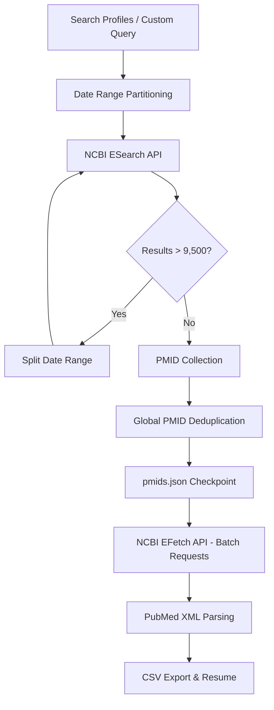

# PubMed Literature Crawler

> **다중 검색식 기반 PubMed 논문 수집 및 중복 제거 자동화**  
> *A reproducible PubMed literature retrieval pipeline with date partitioning, PMID deduplication, and metadata export.*

## 01. Overview

ABC 부트캠프에서 수행했던 PubMed 논문 크롤링 코드를 하나의 프로젝트로 통합했습니다. 여러 주제의 검색식을 통해 PubMed 논문의 식별자(**PMID**)를 수집하고, 검색 기간을 연도 또는 분기 단위로 나누며, **중복 논문을 제거한 뒤 상세 메타데이터를 CSV로 추출**합니다.

기존 세 버전의 코드(다중 검색식, 중복 제거, 분기별 기간 분할)를 비교하여 각 버전의 유효한 기능과 검색식을 보존했습니다. 최종 구현에서는 HTML 크롤링 대신 NCBI 공식 **E-utilities API**를 사용해 유지보수성을 높였습니다.

## 02. Key Features

- **Multi-Query Search**: 여러 PubMed Boolean 검색식을 순차적으로 처리
- **Date Partitioning**: 연도/분기별 검색 및 조회량이 많은 기간의 자동 분할
- **PMID Deduplication**: 검색식과 기간이 중첩돼도 PMID 기준으로 한 번만 저장
- **Metadata Extraction**: 논문 제목, 저자, 기관, 저널, 발행일, 초록, 키워드, DOI 추출
- **Resumable Pipeline**: PMID JSON 체크포인트 저장, CSV 이어받기 지원
- **Request Control**: NCBI API 요청 간격 제한과 제한 횟수 재시도

### Architecture



## 03. Search Profiles

| Profile | 검색 주제 | 원본 |
| --- | --- | --- |
| `synthetic_biology` | 합성생물학·바이오 소재 | `final_pubmed_crawling_code.zip` |
| `agri_biotech` | 농업·육종·유전공학 | `pubmed_no_duplication.zip` |
| `biochip_robot_neuro` | 바이오칩, 로봇 수술, 뇌·신경 관련 주제 | `pubmed_by_ensemble.zip` |
| `all` | 세 그룹 검색식 전체(총 5개) | 전체 통합 |

**재현성 주의:** 두 프로필(`synthetic_biology`, `biochip_robot_neuro`)의 원본 검색식에는 `2012-01-01`~`2024-08-31` 날짜 조건이 이미 들어 있습니다. CLI의 기간 조건은 **추가 필터**입니다. 이 범위 밖의 논문까지 검색하려면 날짜 조건을 제거한 사용자 검색식을 `--query`로 전달하세요. 자세한 비교: [`docs/original-vs-final.md`](docs/original-vs-final.md).

## 04. Tech Stack

- **Language**: Python 3.10+
- **Data Source**: NCBI PubMed / E-utilities (ESearch, EFetch)
- **Processing**: Python `xml.etree.ElementTree`, `csv`, `json` (표준 라이브러리)
- **Testing**: `unittest` (외부 통신 없는 모의 API 테스트)

기존 코드는 BeautifulSoup, Pandas, ThreadPoolExecutor, `urllib.request`를 사용했습니다. 리팩터링 버전은 외부 패키지 없이 Python 표준 라이브러리로 실행됩니다.

## 05. Directory Structure

```text
PubMed-Literature-Crawler/
├── README.md
├── run.py                       # CLI entry point
├── requirements.txt             # Python standard library only
├── config/
│   └── search_profiles.json     # Original search expressions (3 topics / 5 queries)
├── src/pubmed_crawler/
│   ├── cli.py                   # search / fetch / run arguments
│   ├── client.py                # ESearch / EFetch, retry & rate limit
│   ├── search.py                # Period splitting & PMID deduplication
│   ├── parser.py                # XML -> paper metadata
│   └── pipeline.py              # JSON checkpoint, CSV export & resume
├── results/                     # Generated files (ignored by Git)
├── tests/
│   └── test_pipeline.py
└── docs/
    └── original-vs-final.md
```

## 06. Quick Start

아래 명령은 **프로젝트 루트 디렉터리**에서 실행합니다. NCBI에서 요청한 사용자 식별을 위해 실제 연락 가능한 이메일을 환경변수로 지정합니다. 이메일과 API 키는 GitHub 저장소에 하드코딩하지 마세요.

```bash
python --version   # Python 3.10 이상
export PUBMED_EMAIL="your.name@example.com"
# 선택 사항: NCBI 계정에서 발급한 API 키를 사용할 경우
# export NCBI_API_KEY="YOUR_OWN_API_KEY"

# 1) 합성생물학 검색식으로 PMID 수집 및 논문 상세정보 다운로드
python run.py run --profile synthetic_biology

# 2) 여러 검색 주제에서 논문을 찾고 결과를 PMID 기준으로 중복 제거
python run.py run --profile all

# 3) 소량의 데이터를 테스트할 때
python run.py run --profile agri_biotech --max-pmids 30 \
  --pmids-out results/sample_pmids.json --output results/sample_articles.csv
```

수집과 다운로드를 분리할 수 있습니다.

```bash
# 1단계: PMID 목록만 저장
python run.py search --profile biochip_robot_neuro --pmids-out results/pmids.json

# 2단계: 수집한 PMID 목록을 이용해 상세 정보 가져오기
python run.py fetch --pmids-in results/pmids.json --output results/papers.csv

# 다운로드가 중단됐다면 이미 저장된 PMID를 제외하고 재개
python run.py fetch --pmids-in results/pmids.json --output results/papers.csv --resume

# 새 검색식과 날짜 조건을 직접 지정하려면
python run.py run --query '(synthetic biology[Title/Abstract])' \
  --start-date 2023-01-01 --end-date 2024-12-31
```

`run --resume`은 이미 저장된 `pmids.json`을 재사용합니다. **검색식이나 날짜 조건을 변경했다면 새 PMID 파일 경로를 지정하거나 `--resume` 없이 검색부터 다시 수행하세요.**

## 07. Output Schema

| Column | Description |
| --- | --- |
| PMID | PubMed 논문 식별자 |
| Title | 논문 제목 |
| Authors | 저자 목록 |
| Affiliations | 소속 기관 |
| Journal | 학술지 |
| Publication Date | 출판일(원문에 따라 날짜 정밀도 상이) |
| Abstract | 초록 |
| Keywords | 키워드 |
| URL | PubMed 상세 페이지 URL |
| DOI | DOI(없을 수 있음) |

출력은 기본적으로 `results/pmids.json`과 `results/pubmed_results.csv`에 저장됩니다. 데이터가 없는 필드는 빈 값으로 기록합니다. 기존 소스의 `No authors` 등 임의의 결측값 텍스트는 사용하지 않습니다.

## 08. Engineering Decisions

**기존 방식의 제약 → 개선 방향**

- **HTML CSS 선택자 의존** → 공식 XML API 활용
- **페이지마다 직접 스레드 호출** → API 제한을 지키는 순차 요청 + EFetch 배치 처리
- **중복 PMID / 임의 정렬** → 최초 수집 순서를 유지하는 전역 중복 제거
- **무한 재귀 재시도** → 최대 재시도 횟수 지정 + 지수 백오프
- **기간 분할 문자열 조작 오류** → API `mindate`/`maxdate` 사용
- **중도 종료 시 결과 유실 우려** → PMID 체크포인트 + CSV 배치 저장/재개

세 원본 파일에는 각기 다른 주제의 검색식이 포함되어 있습니다. **다중 검색식 결합은 머신러닝 앙상블 학습과 관계가 없습니다.**

## 09. Testing & Limitations

```bash
python -m unittest discover -s tests -v
```

- 테스트는 가짜 PubMed XML 응답을 사용해 기간 분할, 페이지 이동, PMID 중복 제거, 메타데이터 파싱, 재개 처리를 검증합니다.
- 실제 PubMed 전체 데이터 다운로드는 실행 환경·NCBI 서버 상태·데이터 규모에 따라 다르므로, 네트워크 연동 및 결과 건수는 별도로 검증해야 합니다.
- PubMed 인덱스와 메타데이터는 시간에 따라 변경될 수 있습니다. 과거 CSV와 동일한 수집 건수나 완전히 동일한 결과를 보장하지 않습니다.
- NCBI E-utilities 기본 제한은 API 키 없이 **초당 최대 3회**, API 키 사용 시 기본 **초당 최대 10회**입니다. 본 프로젝트는 기본 0.40초 / 키 사용 시 0.12초 간격을 둡니다.
- PubMed 초록 등 데이터의 재사용에는 권리 제한이 있을 수 있습니다. 결과 CSV는 연구 목적과 데이터 이용 조건에 맞춰 관리해 주세요.

**Reference**: [NCBI E-utilities Documentation](https://www.ncbi.nlm.nih.gov/books/NBK25497/) · [NLM API Policy](https://support.nlm.nih.gov/kbArticle/?pn=KA-05510) · [NCBI Disclaimer / Copyright](https://www.ncbi.nlm.nih.gov/About/disclaimer.html)
